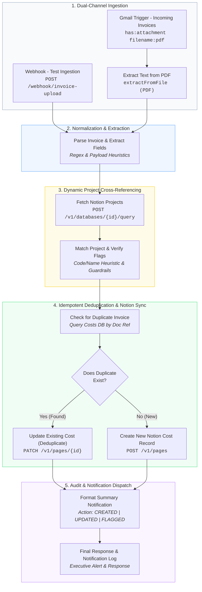

# Kevin's Residential Construction Operations Hub & n8n Invoice Automation

> **Enterprise Business Process Optimization & Automated Cost Accounting System**  
> Built with **n8n**, **Notion API**, and **Python** for residential construction lifecycle management.  
> **Author & Systems Architect:** Shamil Bin Hossain

---

## 🏗️ Project Overview

This operating system automates business workflows, job costing, and executive oversight for **Kevin's Residential Construction Company**. It bridges the operational divide between sales, pre-construction design, field construction, and back-office bookkeeping:

1. **Owner Bottleneck Elimination:** Offloads initial inquiry intake and design agreement drafting to the sales lead while maintaining an executive approval gate (`Needs Kevin's Review`) before client dispatch.
2. **End-to-End Lifecycle Tracking:** A relational project workspace spanning 4 sequential delivery phases (`0. Pre-Contract Estimate / Bid`, `1. Pre-Construction (Office)`, `2. Active Construction (Field)`, `3. Closeout`, and `4. Warranty`) without cluttering executive dashboards with daily field micro-tasks.
3. **Off-App Client Decision Audit Log:** A structured decision ledger capturing change requests made via direct weekend phone calls, texts, or emails to Kevin, automatically alerting field superintendents.
4. **Intelligent & Idempotent Cost Ingestion (n8n):** An automated pipeline ingesting supplier receipts and subcontractor invoices from email attachments or webhooks, extracting financial metadata, validating against active Notion projects, preventing duplicate billings, and flagging ambiguous submissions for human review.

---

## ⚡ System Architecture



### Stage-by-Stage Processing Logic

1. **Dual-Channel Ingestion:**
   * `Webhook - Test Ingestion`: High-speed HTTP endpoint (`POST /webhook/invoice-upload`) supporting direct structured JSON or text payloads.
   * `Gmail Trigger - Incoming Invoices` + `Extract Text from PDF`: Periodically polls for emails with PDF invoice attachments, extracting raw binary text streams.
2. **Payload Normalization & Regex Extraction (`Parse Invoice & Extract Fields`):**
   * Normalizes direct webhook bodies (`item.json.body`) and raw document text.
   * Deterministically parses: `supplier`, `document_reference`, `invoice_date`, `due_date`, `amount`, `currency`, and `payment_status` (detecting `"PAID IN FULL"`, remittances, or net terms).
   * Flags zero amounts, unreadable totals, or missing references upfront.
3. **Dynamic Notion Project Lookup (`Fetch Notion Projects` $\rightarrow$ `Match Project & Verify Flags`):**
   * Dynamically queries the **Construction Projects** database.
   * Matches candidate strings against project codes (`PRJ-101`, `PRJ-102`) or job site descriptions (e.g. `Maple Ave`, `Pinecrest`).
   * **Validation Guardrail:** If an invoice cannot be confidently mapped to a Notion project, it automatically triggers `needs_review = true` and generates a descriptive `review_reason`.
4. **Idempotent Deduplication & Notion Sync (`Check for Duplicate Invoice` $\rightarrow$ `Does Duplicate Exist?`):**
   * Queries the **Project Costs & Invoices** database filtering strictly on `Document Reference`.
   * **Duplicate Found (Branch True):** Executes a `PATCH` request against `https://api.notion.com/v1/pages/{existing_id}` to update `Payment Status` (e.g., from `Unpaid` to `Paid`) and log an audit note without creating redundant records or double-counting costs.
   * **New Record (Branch False):** Executes a `POST` request against `https://api.notion.com/v1/pages` inserting the expense, linking it to the matched `Project` relation, and populating review checkboxes/reasons as needed.
5. **Operational Audit & Notification Dispatch (`Format Summary Notification` $\rightarrow$ `Final Response & Notification Log`):**
   * Formats an executive summary specifying the action taken (`CREATED`, `UPDATED (Deduplicated)`, or `FLAGGED FOR REVIEW`), project name, supplier, amount, and reference number.

---

## 🗄️ Notion Relational Architecture & Schemas

The workspace is built on **8 interconnected relational databases**:

```
Contacts ◄──────► Sales Opportunities (CRM) ◄──────► Sales Activities
   │                         │
   └──────────┐  ┌───────────┘
              ▼  ▼
      Construction Projects ◄──────► Project Milestones
              ▲
              ├────────────────────► Materials & Deliveries
              ├────────────────────► Client Decision & Comm Log
              └────────────────────► Project Costs & Invoices (n8n Ingestion Hub)
```

### Core Schema: Construction Projects (`41cdc5b5-17bb-8172-a52a-e0990393f4e2`)
* `Project Name` (*Title*): Full project title (e.g., `"Maple Ave Custom Build"`).
* `Project Code` (*Rich Text*): Unique site tracking identifier (e.g., `PRJ-101`, `PRJ-102`).
* `Current Phase` (*Select*): `0. Pre-Contract Estimate / Bid`, `1. Pre-Construction (Office)`, `2. Active Construction (Field)`, `3. Closeout`, `4. Warranty`.
* `Overall Health` (*Select*): `On Track`, `At Risk / Delayed`, `Waiting on Client Decision`, `Completed`.
* `Client` (*Relation*): Bi-directional link to `Contacts` database.
* `Office Coordinator` (*Select*): Responsible office project lead.
* `Field Lead` (*Select*): On-site superintendent.
* `Total Approved Budget ($)` (*Number / Dollar*): Master contract baseline.
* `Start Date` / `Target Completion` (*Date*): High-level phase schedules.
* `Scope Summary` (*Rich Text*): Architectural summary and execution notes.

### Core Schema: Project Costs & Invoices (`41cdc5b5-17bb-81c1-b293-ceead658b242`)
* `Invoice / Receipt Title` (*Title*): Formatted as `{Supplier} - {Doc Ref}`.
* `Project` (*Relation*): Direct relational link to the corresponding `Construction Projects` record.
* `Supplier / Vendor` (*Rich Text*): Trade contractor or material supply vendor name.
* `Document Reference` (*Rich Text*): Unique supplier invoice number (used for idempotent deduplication).
* `Invoice Date` (*Date*): Date issued by vendor.
* `Due Date` (*Date*): Payment maturity date (if provided).
* `Amount` (*Number / Dollar*): Total invoiced monetary value.
* `Currency` (*Select*): `USD`, `CAD`, `EUR`, `GBP`.
* `Payment Status` (*Select*): `Paid`, `Unpaid`, `Partially Paid`.
* `Needs Clarification / Review` (*Checkbox*): Guardrail flag for unmatched projects, zero totals, or discrepancies.
* `Review / Flag Reason` (*Rich Text*): Detailed human explanation generated by validation logic.
* `Source Email / Attachment Info` (*Rich Text*): Origin audit trail (e.g., filename, upload mechanism).

---

## 📁 Repository Structure

```
.
├── README.md                                                        # System documentation & evaluation manual
├── requirements.txt                                                 # Python dependencies
├── run_tests.sh                                                     # Shell test runner executable
├── test_automation_runner.py                                        # Local end-to-end Python pipeline
├── generate_test_invoices.py                                        # PDF invoice generator
├── setup_notion.py                                                  # Initial workspace & database builder
├── build_dashboard_and_templates.py                                 # Executive KPI dashboard & checklist generator
├── fix_notion_page.py                                               # Workspace maintenance utility
├── notion_config.json                                               # Active database IDs & sample project mapping
├── .env.example                                                     # Sanitized environment variable template
├── .gitignore                                                       # Git exclusion rules
├── workflows/
│   └── Kevin_Construction_Invoice_Cost_Ingestion_Workflow.json      # Production importable n8n workflow
├── sample_payloads/
│   ├── 1_clean_invoice.json                                         # Valid new invoice payload (Titan Steel)
│   ├── 2_duplicate_invoice.json                                     # Duplicate payment update (BuildPro Lumber)
│   ├── 3_incomplete_invoice.json                                    # Missing project & zero dollar flag test
│   └── 4_raw_text_invoice.json                                      # Unstructured email body text test
└── test_invoices/
    ├── 1_Apex_Lumber_INV-2026-881_Unpaid.pdf                        # Clean unpaid PDF invoice
    ├── 2_Apex_Lumber_INV-2026-881_PAID_Update.pdf                  # Paid remittance update PDF invoice
    └── 3_Unknown_Vendor_Missing_Project.pdf                         # Missing project review test PDF invoice
```

---

## 🚀 Setup & Installation Instructions

### 1. Prerequisites
* Python 3.10+
* An n8n instance (Self-hosted via Docker, Desktop app, or n8n Cloud)
* A Notion account with an Internal Integration token created at [notion.so/my-integrations](https://www.notion.so/my-integrations)

### 2. Configure Environment Variables
Copy `.env.example` to `.env` and supply your credentials:
```bash
cp .env.example .env
```
Populate `.env`:
```env
NOTION_TOKEN=ntn_your_actual_internal_integration_token
NOTION_PAGE_ID=41cdc5b517bb80bfafd4f1bfbe5667de
NOTION_PROJECTS_DB_ID=41cdc5b5-17bb-8172-a52a-e0990393f4e2
NOTION_COSTS_DB_ID=41cdc5b5-17bb-81c1-b293-ceead658b242
N8N_WEBHOOK_URL=http://localhost:5678/webhook/invoice-upload
```

### 3. Import & Configure the n8n Workflow
1. Open your n8n interface $\rightarrow$ Navigate to **Workflows** $\rightarrow$ Click **Add Workflow** $\rightarrow$ **Import from File**.
2. Select [`workflows/Kevin_Construction_Invoice_Cost_Ingestion_Workflow.json`](workflows/Kevin_Construction_Invoice_Cost_Ingestion_Workflow.json).
3. If running self-hosted, set environment variable `NOTION_TOKEN` in your n8n runtime, or edit the `Authorization` header in the HTTP Request nodes.
4. Toggle the workflow to **Active** (or click **Test Workflow** to listen for webhook calls).

---

## 🧪 End-to-End Verification Guide

You can verify the entire pipeline using either the automated local runner or direct `curl` commands against the live n8n webhook:

### Method A: Automated Local Runner (One Command)
Run the automated test suite which executes all 3 generated PDF invoices against your Notion workspace:
```bash
./run_tests.sh
```

### Method B: Single-Line `curl` Verification (All 4 Scenarios)

#### Test Case 1: Clean New Invoice Ingestion
* **Goal:** Verify that a standard unpaid invoice maps to the correct project and creates a new cost record.
```bash
curl -X POST http://localhost:5678/webhook/invoice-upload \
  -H "Content-Type: application/json" \
  -d @sample_payloads/1_clean_invoice.json
```
* **Expected Outcome:** 
  * Notion creates a new row: `Titan Steel Fabricators - INV-2026-904`.
  * Linked to Project: `[PRJ-102] Pinecrest Addition`.
  * Amount: `$6,400.00`, Status: `Unpaid`.
  * `Needs Clarification / Review`: Unchecked (`false`).

#### Test Case 2: Idempotent Deduplication & Status Update
* **Goal:** Verify that re-submitting an existing invoice reference (`INV-BPL-8821`) updates the payment status to `Paid` without creating a duplicate record or double-counting costs.
```bash
curl -X POST http://localhost:5678/webhook/invoice-upload \
  -H "Content-Type: application/json" \
  -d @sample_payloads/2_duplicate_invoice.json
```
* **Expected Outcome:** 
  * Notion finds existing page for `INV-BPL-8821`.
  * `PATCH` updates `Payment Status` $\rightarrow$ `Paid`.
  * No duplicate row is added; total project expenses remain accurate.

#### Test Case 3: Incomplete Invoice & Validation Guardrails
* **Goal:** Verify that invoices with missing projects or zero amounts are flagged for review.
```bash
curl -X POST http://localhost:5678/webhook/invoice-upload \
  -H "Content-Type: application/json" \
  -d @sample_payloads/3_incomplete_invoice.json
```
* **Expected Outcome:** 
  * Notion creates record: `Summit Electrical Supply - INV-2026-999`.
  * `Needs Clarification / Review`: Checked (`true`).
  * `Review / Flag Reason`: `"Missing project name/code. Cannot match to Notion Projects database. | Zero or unreadable invoice amount."`.
  * Project relation: Empty (unassigned).

#### Test Case 4: Unstructured Text / OCR Extraction
* **Goal:** Verify that unstructured email/PDF body text is correctly parsed by the regex engine.
```bash
curl -X POST http://localhost:5678/webhook/invoice-upload \
  -H "Content-Type: application/json" \
  -d @sample_payloads/4_raw_text_invoice.json
```
* **Expected Outcome:** 
  * Regex extracts supplier `"Harbor Mechanical & Plumbing"`, reference `"INV-2026-955"`, amount `$3,750.00`, and hint `"PRJ-101"`.
  * Notion creates row linked to `[PRJ-101] Maple Ave Custom Build`.

---

## 👨‍💻 Author & Attribution

* **Architecture, Workflows & Documentation:** **Shamil Bin Hossain**
* **Project Repository:** [Construction-operation-hub](https://github.com/shamilhossain/Construction-operation-hub)
